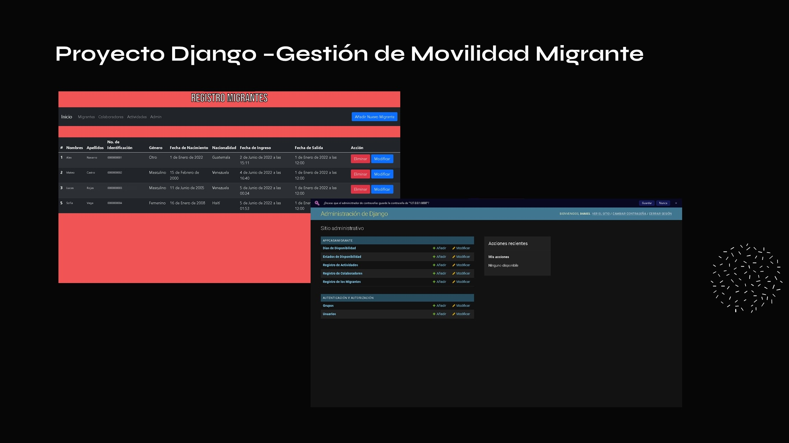
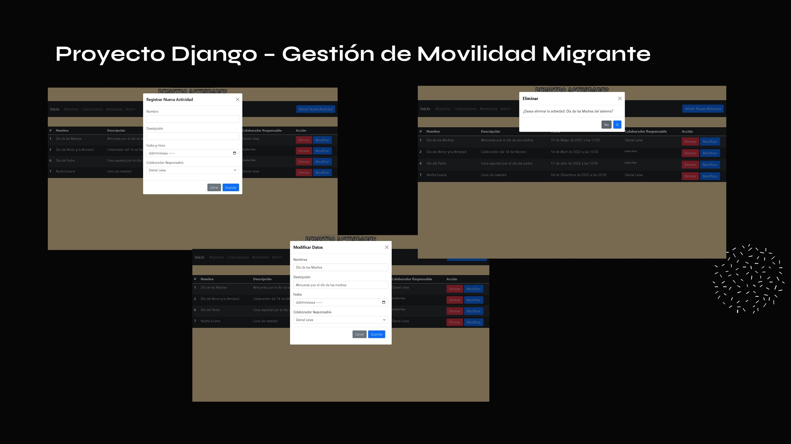

# Gestión de Casa de Migración — Django

Aplicación web desarrollada con **Django** para la gestión administrativa de una Casa de Migración, con módulos CRUD para el registro de migrantes, colaboradores, actividades y catálogos de disponibilidad.

## Vista previa

| Registro de migrantes y Django Admin | Registro de actividades |
| :---: | :---: |
|  |  |

## Características principales

- **Registro de migrantes (`migrantes/`):** Alta, edición, listado y eliminación de registros (`nombres`, `apellidos`, `no_identificacion`, `genero`, `fecha_nacimiento`, `nacionalidad`, `fecha_ingreso` y `fecha_salida`).
- **Gestión de colaboradores (`colaboradores/`):** Registro y actualización de colaboradores asociados a estados y días de disponibilidad.
- **Registro de actividades (`actividades/`):** Programación y mantenimiento de actividades con descripción, fecha y colaborador responsable.
- **Panel administrativo:** Registro de los cinco modelos en **Django Admin** (`RegistroMigrante`, `RegistroColaborador`, `RegistroActividad`, `EstadoDisponible`, `DiasDisponible`).

## Tecnologías utilizadas

- **Python 3.10**
- **Django 4.0.5** (ORM, migraciones, plantillas y Django Admin)
- **SQLite** (base de datos local por defecto)
- **Pipenv** (`Pipfile` y `Pipfile.lock`)

## Contexto y estado del proyecto

- **Contexto:** Proyecto académico desarrollado en 2022 que conserva su implementación original con fines demostrativos (`DEBUG = True`, `ALLOWED_HOSTS = ['*']` y `SECRET_KEY` de ejemplo en `settings.py`). **No está preparado para entornos de producción.**
- **Estado:** Finalizado (archivado para portafolio). La base de datos local `db.sqlite3` está excluida del repositorio mediante `.gitignore` y debe generarse localmente ejecutando las migraciones de Django (`python manage.py migrate`).

## Autor

**Daniel Alejandro Arita Leiva**
